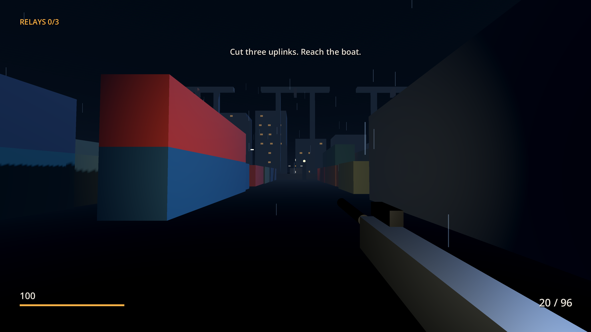

# Saltline — native 3D on PS5

A native PlayStation 5 homebrew port of **Saltline**, originally a Three.js browser
game. It runs on a **Godot 4.7.2 PS5 runtime rebuilt with 3D enabled**, drives the
DualSense from inside the title process (two-motor rumble + adaptive-trigger
effects), and ships as a plain folder that **ShadowMount+** mounts from a USB drive.



## What works

| Feature | Status | Notes |
|---|---|---|
| Native 3D title | ✅ | `Node3D` / `MeshInstance3D` / `Camera3D` / `GodotPhysics3D`, 1920×1080 |
| Level & gameplay | ✅ | container yard, cranes, three uplinks, extraction boat, walker enemies |
| DualSense rumble | ✅ | classic two-motor mode (`scePadSetVibrationMode(2)`), strength varies per event |
| Adaptive triggers | ✅ | slope-feedback L2/R2 curves, weapon kick, empty-mag/reload/damage pulses |
| Gamepad input | ✅ | sticks, analog L2/R2, buttons via the engine's `scePadRead` bridge |
| Performance | ✅ | ~58–59 fps at 1080p with shadows off (toggle in the pause menu) |
| USB / ShadowMount | ✅ | app folder under `/mnt/usb0/homebrew/<TITLE_ID>`, auto-mounted and registered |
| Launch automation | ✅ | payload launcher (`tools/launch_3d.sh`) in addition to the home-screen tile |

The player has verified that the pad actually rumbles and that the trigger
resistance changes; the engine log shows the matching
`[GodotPS5 PAD] HAPTICS … vib=… l2=… r2=…` stream while playing.

## How it is put together

* **Engine** — upstream Godot 4.7.2 plus the community PS5 platform overlay,
  rebuilt with a `smoke3d` module set: 3D scene layer, `GodotPhysics3D`,
  FreeType, GLES3 renderer, native AudioOut. The stock port compiles with
  `disable_3d=yes`; this project turns it back on.
* **Game** — a Godot project in `game/` (`main3d.tscn`): procedural harbour
  blockout, first-person player, rifle with hitscan, walkers, relays, HUD,
  haptics presets and adaptive-trigger hooks.
* **Haptics** — `engine-overlay/pad_ps5.cpp` opens the pad in the title process,
  switches to classic vibration mode, and polls `user://pad_state`. The game's
  `Pad` autoload writes that file (atomically) with the current motor levels and
  L2/R2 trigger-effect shapes; the driver forwards them with
  `scePadSetVibration` / `scePadSetTriggerEffect`.
* **Packaging** — the PS5-DevBridge linker binds the engine archives into a
  signed `eboot.bin`, and `tools/deploy_3d.sh` uploads the folder over FTP.

## Requirements

Console (all standard homebrew tools):

* jailbroken PS5 with an ELF loader on TCP `9021` and an FTP server on `2121`
* ShadowMount+ (scans `/mnt/usb0/homebrew`)
* a USB drive mounted at `/mnt/usb0`

Development host:

* macOS on Apple silicon (the scripts assume macOS tool names; Linux is close)
* LLVM 20 for macOS arm64, extracted to `vendor/LLVM-20.1.8-macOS-ARM64`
  (download from <https://github.com/llvm/llvm-project/releases>)
* Python 3.11+ (the packaging scripts use `hashlib.file_digest`)
* `git`, `curl`, `unzip`, and a C toolchain able to build GNU bash
  (`tools/build_engine_3d.sh` builds a local bash 5 for the Linux-oriented
  DevBridge scripts)
* network access to fetch Godot, PS5-DevBridge, the PS5 payload SDK and the
  ps5-opengl SDK mirror

## Build

```sh
export PS5_HOST=<console-ip>      # required by the deploy/launch tools

tools/setup_toolchain.sh          # payload SDK + zig LLD + SCons
tools/build_engine_3d.sh          # Godot 4.7.2 + PS5 overlay, 3D module set (10–20 min)
TITLE_ID=PPSA99700 tools/build_app_3d.sh   # engine archives + PCK -> signed app folder
TITLE_ID=PPSA99700 tools/deploy_3d.sh      # upload, let ShadowMount mount it
tools/launch_3d.sh                # optional: start the title from a payload
```

`build_app_3d.sh` is self-contained: it fetches the host zlib, the runtime
`libc.prx` from the official engine release (SHA-256 checked), and applies the
weak-TLS `--defsym` fallback that the PS5 SELF converter needs.

## Controls

| Input | Action |
|---|---|
| Left stick | move |
| Right stick | aim |
| L2 | aim down sights (analog, trigger resistance ramps) |
| R2 | fire (analog; trigger slope firms up through the travel) |
| Cross | jump |
| Circle | crouch |
| Square | reload |
| Triangle | cut uplink (when the prompt is visible) |
| R1 | melee |
| Options | pause |

Pause menu: **Shadows ON/OFF**, **Haptics ON/OFF**, **Controller test**
(rumble pattern + 2.4 s of trigger resistance).

## Trigger / rumble protocol

`user://pad_state` is one ASCII line:

```
seq vibLarge vibSmall l2Mode a b c d r2Mode a b c d
```

* `vibLarge` / `vibSmall`: 0–255, classic DualSense motors.
* trigger modes: `0` off, `1` feedback(pos, strength), `2` weapon(start, end,
  strength), `3` vibration(pos, amplitude, frequency), `5` slope(start, end,
  startStrength, endStrength).
* The game writes a temp file and renames it into place so the engine's reader
  never sees a truncated line.

The engine driver only talks to its own title's pad handle, so there is no
separate daemon, no `ptrace`, and no interaction with system processes.

## Title ID

The app folder uses **`PPSA99700`**. Older iterations used `LAPY00001` /
`PPSA99847`; after those folders were deleted the system database kept a
`deleted:true` content flag for them, which makes ShadowMount skip registration
and makes the launch APIs report the title as unknown. Using a fresh ID lets
ShadowMount register the folder cleanly. Do **not** hand-edit `app.db` to work
around this — a previous attempt while the database was in use triggered a
system database rebuild.

## Known limitations

* The 3D content is a procedural, stylised recreation of the browser game, not a
  pixel-for-pixel port. Materials, set dressing and level layout can be extended.
* The PS5's built-in browser has no WebGL/GPU acceleration, so running the
  original Three.js page directly is not an option.
* PS5's Gallium GL stack resolves MSAA in software; MSAA must stay off
  (`msaa_3d=0`) or frame time collapses.
* Directional shadows cost about 5 fps; they are off by default and can be
  enabled in the pause menu.

## Troubleshooting

| Symptom | Cause / fix |
|---|---|
| FTP `550 Text file busy` while uploading `eboot.bin` | close the running title first |
| App installs but no home-screen tile | content flagged deleted; use a fresh title ID |
| Link fails: `no public SDK stub exports required symbol _ZTH…` | weak TLS hooks; `build_app_3d.sh` applies the `--defsym` fallback |
| `runtime/libc.prx` rebuild fails on macOS | `stat -c` and host-zlib differences; the script reuses the official signed runtime and patches the host build |
| Launch API returns `0x80940005` | pass the 1024-byte LNC param (size + foreground user), not `NULL` |

## Third-party

* [Godot Engine](https://godotengine.org) 4.7.2 (MIT)
* PS5 platform overlay and native-link tooling from the PS5 Godot / PS5-DevBridge
  projects (MIT/GPL as per their repositories)
* [ps5-opengl](https://github.com/mihawk-99/ps5-opengl) SDK (mirrored release,
  GPL-3.0)
* [ps5-payload-sdk](https://github.com/ps5-payload-dev/sdk) and
  [elfldr](https://github.com/ps5-payload-dev/elfldr)

No license has been chosen for the game-specific code in `game/`,
`engine-overlay/` or `tools/`; add one before redistributing.
